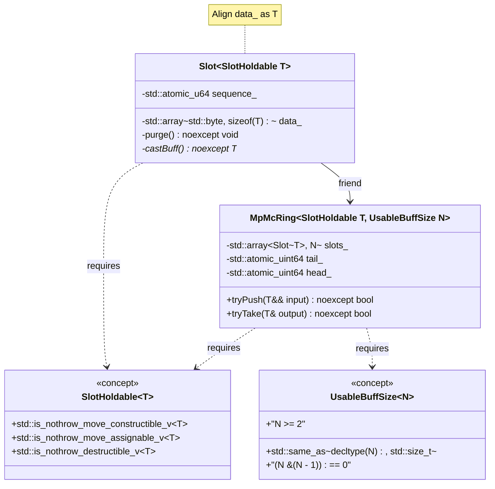

# Slot

## Purpose
The purpose of a slot is to allow safe access to a resource from multiple threads.
The implementation should remain in user space. It may block, but also provides
opportunistic access. Its design is based on the slot in a Vyukov-esque MPMC queue.

## Class diagram

### Note on N & (N - 1) == 0
For UsableBuffSize, note that $\forall n \in \mathbb{N}, n \geq 2: n \land (n-1) = 0 \iff n \in \{2^k \mid k \in \mathbb{N},\ k \gt 0\}$.

$n \land (n-1) = 0 \Rightarrow n \in \{2^k \mid k \in \mathbb{N},\ k \gt 0\}$

Noting that $n \geq 2$ and that binary can be expressed as $n = \sum_{k=0}^{m}b_k2^k, b_k \in \{0,1\}$.
We can then express n as $n=2^m + p, 0 \leq p \lt 2^m$, where p is whatever remains after the most significant bit.

Let us assume that $p \gt 0$

Then it follows that $n = 2^m + p \iff n - 1 = 2^m + (p - 1), \therefore n \land (n-1) = (2^m + p) \land (2^m + (p - 1))$.
We can now call upon the observation that $2^m \gt p \gt p - 1$ and that $2^m = 2^m + \sum_{k=0}^{m-1}b_k2^k, b_k \in \{0\}$.

Hence, $2^m + v = 2^m \lor v, 0 \leq v \lt 2^m, v \in \mathbb{N}$.

And, $(2^m + p) \land (2^m + (p-1)) = (2^m \lor p) \land (2^m \lor (p - 1)) = 2^m \lor (p \land (p - 1))$.

This would finally yield $n \land (n-1) = 2^m \lor (p \land (p-1)) = 0$; however, $2^m$ and $p \land (p-1)$ are disjoint, creating a contradiction.
Hence, $n = 2^m.$

$\square$

$n \land (n-1) = 0 \Leftarrow n \in \{2^k \mid k \in \mathbb{N},\ k \gt 0\}$

Observing that the binary representation of n can be written as $n = 2^m = 2^m + \sum_{k=0}^{m-1} 0 \cdot 2^k$

and noting that $2^m - 1 \lt 2^m$ we can observe that $2^m$ and $(2^m - 1)$ are disjoint. Hence, $2^m \land (2^m - 1) = 0 \iff n \land (n-1) = 0$.

$\square$
